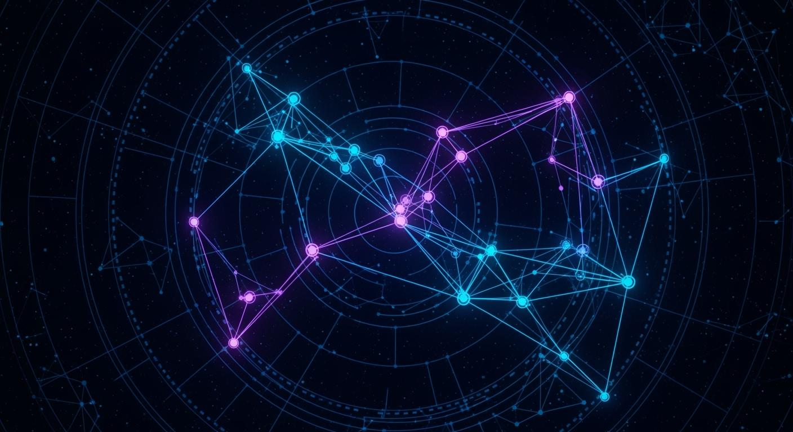
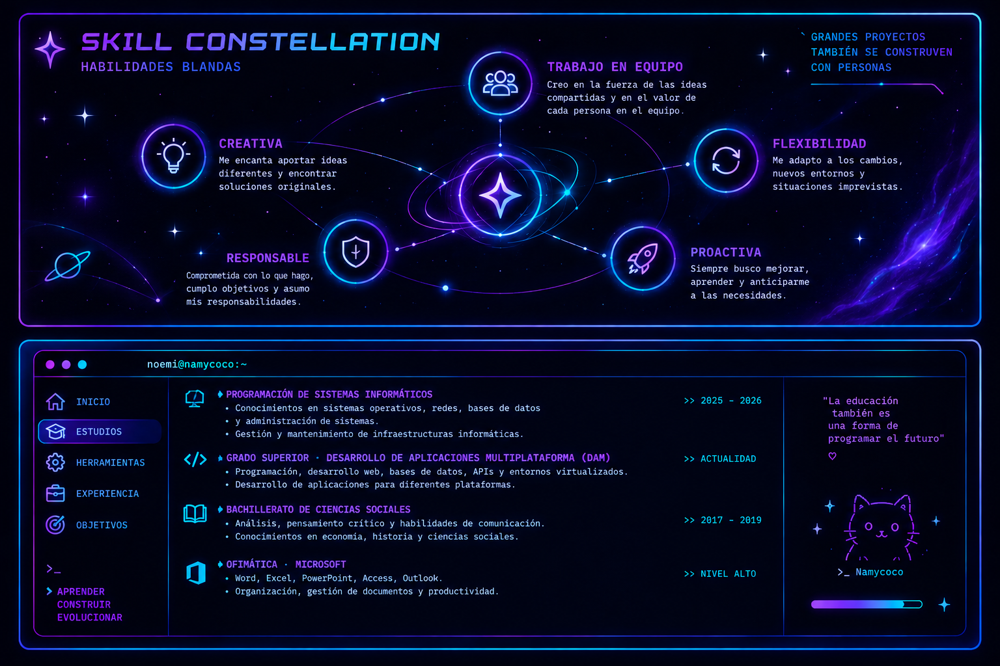
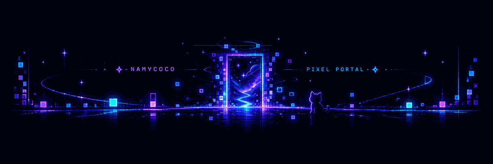

<!-- 🌌 NAMYCOCO · FUTURISTIC PROFILE README 🌌 -->

 
<!--
<p align="center">
  
</p>

-->

<h1 align="center">

  ・‥…━━━━━━━☆


  
</h1>

<h3 align="center">
  ✨ DESARROLLADORA DE APLICACIONES MULTIPLATAFORMA ✨
  
  

  
</h3>

<p align="center">
  <strong>💻 Código · 🚀 Creatividad · 🌌 Innovación · 💡 Futuro</strong>
</p>

<p align="center">
  
  
  
</p>

---

## 💫 01 · SOBRE MÍ

¡Hola! Soy **Noemí**, estudiante de **Desarrollo de Aplicaciones Multiplataforma (DAM)**, apasionada por la tecnología, la programación y la creación de soluciones digitales.

▼ Me gusta transformar ideas en proyectos reales, explorar nuevas herramientas y aprender constantemente.

▼ Mi formación incluye programación, desarrollo web, sistemas informáticos, control de versiones y entornos virtualizados.

▼ Mi objetivo es seguir creciendo como desarrolladora, construir proyectos propios y convertir cada reto en una oportunidad para aprender.

> ➤ *La creatividad imagina el futuro; el código lo hace posible.*

---

<!-- ⫘⫘⫘⫘⫘⫘ SKILL CONSTELLATION + PERSONAL TERMINAL ─•────-->

<h2 align="center">⌬ SKILL CONSTELLATION · PERSONAL TERMINAL</h2>

<p align="center">  </p>

██████████████████████████████████████████████████████████████████████████████████▒▒▒▒▒
```text
> booting_namycoco_system...
> loading_skills...........[OK]
> creativity..............[MAX]
> learning_mode...........[ACTIVE]
> future_developer........[IN PROGRESS]

[████████████████████] 100%

✦ SYSTEM READY — LET'S BUILD SOMETHING.
```


## 🪐 02 · MI UNIVERSO TECNOLÓGICO

### 💻 LENGUAJES DE PROGRAMACIÓN

<p align="center">
  
</p>

<p align="center">
  
  
  
  
  
</p>

### ⚙️ HERRAMIENTAS Y ENTORNOS

<p align="center">
  
</p>

<p align="center">
  
  
  
  
  
</p>

### 🖥️ SISTEMAS Y VIRTUALIZACIÓN

<p align="center">
  
  
</p>

---

## 🔮 03 · LO QUE ME MOTIVA

<p align="center">
  💡 <strong>CREAR</strong> &nbsp; ◈ &nbsp;
  🧠 <strong>APRENDER</strong> &nbsp; ◈ &nbsp;
  🛠️ <strong>EXPERIMENTAR</strong> &nbsp; ◈ &nbsp;
  🚀 <strong>EVOLUCIONAR</strong>
</p>

Estoy desarrollando mis habilidades mediante la práctica, nuevos retos y proyectos que me permiten explorar distintas áreas del mundo tecnológico.

**Mi filosofía:** aprender, construir, mejorar y volver a intentarlo.

---

## 🌠 04 · MI ACTIVIDAD EN GITHUB


## ⚡ GITHUB // LIVE DASHBOARD

<p align="center">
  
</p>


<p align="center">
  
</p>

<p align="center">
  
  
  
</p>

<p align="center">
  <em>「 Cada commit es un paso hacia una versión mejor de mí. 」</em>
</p>


##  05 · CONECTA CONMIGO ▮▮▮▮▮▮▮▮▮▮▮▮▮▮▮▮▮▮▮▮

<p align="center">
  <a href="https://github.com/Namycoco">
    
  </a>
</p>

<p align="center">
  <strong>🌌 Construyendo mi futuro, una línea de código a la vez.</strong>
</p>

<p align="center">
  <sub>✨ CODE YOUR DREAMS · CREATE YOUR FUTURE ✨</sub>
</p>

---

## 🧬 THE NOEMI LAB

<p align="center">
  
</p>

<p align="center">
  <strong>Un laboratorio digital donde la curiosidad es el combustible y el código es la herramienta.</strong>
</p>

<table>
  <tr>
    <td width="50%" valign="top">

### 🧪 EXPERIMENTO_001

**Imaginación aplicada**

Explorar ideas, diseñar soluciones y convertir conceptos en proyectos reales.

`STATUS: HTML5, CSS, HeidiSQL, Xampp, Apache2, mariadb`

[🌐 Cursos Web](https://namycoco.github.io/cursos-web/) · [ 👑 Mini Trello Margaret](https://namycoco.github.io/PythonNew/)

</td>
<td width="50%" valign="top">

### 🧬 EXPERIMENTO_002

**Lógica en construcción**

Aprender nuevos lenguajes, resolver problemas y descubrir mejores formas de programar.

`STATUS: API Integration`

[.𖥔 ݁ ˖🛸── .✦Simulador Alien ](https://github.com/Namycoco/controlador) · [☄️ Asteroide](https://github.com/Namycoco/asteroide) · [🌦️ Weather](https://github.com/Namycoco/weather)

</td>
</tr>
<tr>
<td width="50%" valign="top">

### 🔮 EXPERIMENTO_003

**Nuevos universos**

Investigar tecnologías, herramientas y posibilidades más allá de lo conocido.

`STATUS: Video Games with Godot and Unity`

[🍎 Delicious Apples](https://github.com/Namycoco/deliciousapples) · [🐉 Green Wings](https://github.com/Namycoco/namycoco.github.io)

</td>
<td width="50%" valign="top">

### 🚀 EXPERIMENTO_004

**De idea a realidad**

Construir proyectos propios, experimentar sin miedo y mejorar con cada intento.

`STATUS: HTML5 - CSS - JAVASCRIPT - PYTHON`

[🧮 Calculadora de Nóminas](https://github.com/Namycoco/calcular_nomina) · [ 📅 Tablas de multiplicar](https://github.com/Namycoco/tablas_multiplicar)

</td></tr>
</table>


<p align="center">
  
  
</p>


<h2 align="center">★・・・・・・★★・・・・・・★★・・・・・・★★・・・・・・★★・・・・・・★★・・・・・・★</h2>

<!--
<p align="center">
  
</p>

-->

<p align="center">
  <em>«Las mejores ideas empiezan con un “¿y si lo intento?”»</em>
</p>
---


